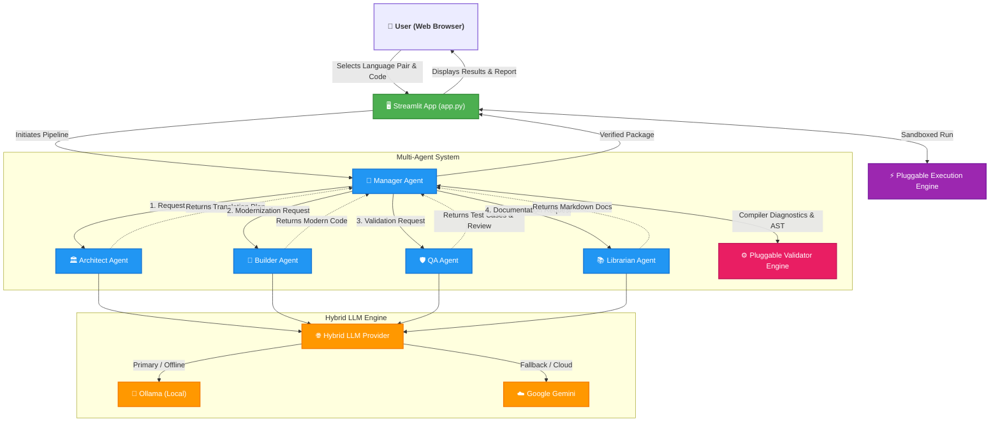

<div align="center">
  <h1>⚡ Modernize the Code (MTC)</h1>
  <p><strong>Multi-Agent Cross-Language Modernization & Migration Architecture with Local & Cloud LLMs</strong></p>
  
  [](https://www.python.org/downloads/)
  [](https://www.oracle.com/java/)
  [](https://streamlit.io/)
  [](https://ollama.ai/)
  [](https://ai.google.dev/)
</div>

---

## 📖 Overview

**Modernize the Code (MTC)** is an intelligent, multi-agent AI system engineered to automatically analyze, refactor, translate, test, and document code across language boundaries (e.g., Python ➔ Java, Java ➔ Python, Legacy Python ➔ Modern Python 3.11+, Legacy Java ➔ Modern Java 21 LTS). Built around an Agent-to-Agent (A2A) paradigm, it uses specialized AI agents that collaborate sequentially, implementing self-healing workflows backed by native compiler diagnostics (`javac` and `ast`) to guarantee zero-hallucination, syntactically valid, production-grade code.

The system natively operates using local LLMs (via **Ollama**) for data privacy and offline capability, with seamless fallback capabilities to cloud-based models (via **Google Gemini**) for rapid experimentation.

---

## ✨ Three Core Architectural Layers

1. **Dynamic Language Strategy Layer (`core/languages.py`)**:
   - Modular language matrix decoupling language idioms, syntax rules, and anti-hallucination directives from prompts.
   - Enforces 100% implementation completion (zero `// TODO` or `pass` placeholders) and idiomatic target standards.
   - First-class support for **Python (3.11+)** and **Java (21 LTS)**, with simple registry hooks for additional languages.

2. **Pluggable Validator Engine (`core/validators.py`)**:
   - Language-aware validation interface (`BaseSyntaxValidator`).
   - **Python**: Native Abstract Syntax Tree (`ast.parse`) checking with line/column pointers.
   - **Java**: Native JDK `javac` compiler execution (`javac -Xlint:none -d ...`), capturing precise compiler errors and line numbers with zero hallucinations.

3. **Pluggable Execution Engine (`core/executor.py`)**:
   - Sandboxed runtime runner for immediate verification.
   - **Python**: Dynamic execution via `sys.executable`.
   - **Java**: Ephemeral compilation and execution via `javac` & `java`.
   - Returns standardized `ExecutionResult` tuples for both original and modernized code.

---

## 🏗️ Architecture & Workflow



---

## 📁 Project Structure

```text
MTC/
│
├── app.py                  # Streamlit Interactive Dashboard
├── config.py               # Global configuration & dynamic prompt interfaces
├── requirements.txt        # Python package dependencies
│
├── core/                   # Core application architecture
│   ├── languages.py        # Layer 1: Dynamic Language Strategy & Registry
│   ├── validators.py       # Layer 2: Pluggable Validator Engine (AST & Javac)
│   ├── executor.py         # Layer 3: Pluggable Execution Engine (Python & Java)
│   ├── llm_provider.py     # Hybrid LLM fallback provider
│   ├── model_manager.py    # Local model lifecycle manager
│   └── protocol.py         # Standard Pydantic schemas (TaskResult)
│
├── agents/                 # Intelligent AI Agent Definitions
│   ├── manager.py          # Orchestrator & Self-Healing Loop
│   ├── base_agent.py       # Base agent inheritance & resilient JSON parser
│   ├── architect.py        # Polyglot analysis & modernization planner
│   ├── builder.py          # Modernization & cross-language translation engine
│   ├── qa.py               # Test-case generator & logic reviewer
│   └── librarian.py        # Technical documentation generator
│
└── utils/                  # Helper utilities
    └── validators.py       # Facade for ValidatorFactory
```

---

## 🚀 Installation & Setup

### 1. Prerequisites

- Python 3.9+ installed.
- (Optional) Java JDK installed if compiling and executing Java code locally.
- (Optional) [Ollama](https://ollama.com/) if running in Local AI Mode.

### 2. Set Up Virtual Environment

```bash
python -m venv .venv
# Windows:
.venv\Scripts\activate
# Linux/macOS:
source .venv/bin/activate
```

### 3. Install Dependencies

```bash
pip install -r requirements.txt
```

---

## 🎮 Usage

Launch the MTC toolkit by running:

```bash
streamlit run app.py
```

1. **Select Mode:** Choose between Local (Ollama) or Cloud (Gemini) on the sidebar.
2. **Select Language Pair:** Choose Source Language (e.g. Python) and Target Language (e.g. Java).
3. **Submit Code:** Paste your legacy script.
4. **Execute:** Click "Execute Modernization Pipeline".
5. **Inspect & Execute:** Run original and modernized code side-by-side using the live execution engine, run auto-generated tests, and download the full Markdown migration report.
